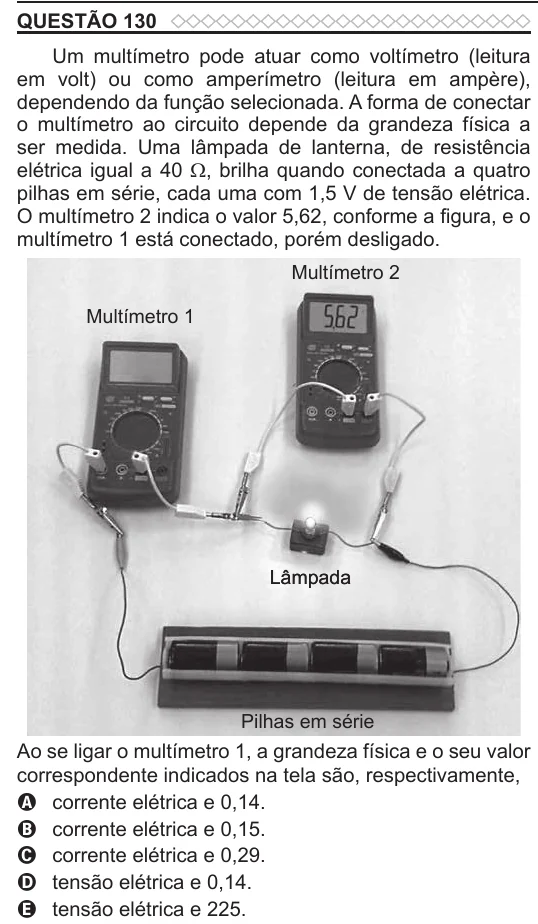

Texto extraído (pode conter ruído)

QUESTÃO 130  
Um multímetro pode atuar como voltímetro (leitura  
em volt) ou como amperímetro (leitura em ampère),  
dependendo da função selecionada. A forma de conectar  
o multímetro ao circuito depende da grandeza física a  
ser medida. Uma lâmpada de lanterna, de resistência  
elétrica igual a 40 Ω, brilha quando conectada a quatro  
pilhas em série, cada uma com 1,5 V de tensão elétrica.  
O multímetro 2 indica o valor 5,62, conforme a figura, e o  
multímetro 1 está conectado, porém desligado.  
Multímetro 2  
Multímetro 1  
Lâmpada  
Pilhas em série  
Ao se ligar o multímetro 1, a grandeza física e o seu valor  
correspondente indicados na tela são, respectivamente,  
A corrente elétrica e 0,14.  
B corrente elétrica e 0,15.  
C corrente elétrica e 0,29.  
D tensão elétrica e 0,14.  
E tensão elétrica e 225.

