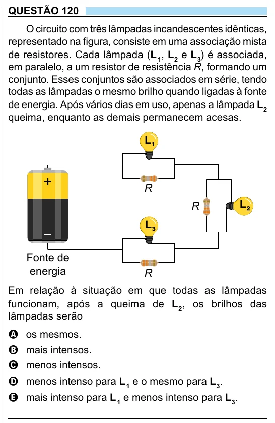

Texto extraído (pode conter ruído)

QUESTÃO 120  
O circuito com três lâmpadas incandescentes idênticas,  
representado na figura, consiste em uma associação mista  
de resistores. Cada lâmpada (L 1 , L 2 e L 3 ) é associada,  
em paralelo, a um resistor de resistência R, formando um  
conjunto. Esses conjuntos são associados em série, tendo  
todas as lâmpadas o mesmo brilho quando ligadas à fonte  
de energia. Após vários dias em uso, apenas a lâmpada L 2  
queima, enquanto as demais permanecem acesas.  
L  
¹  
R  
L  
R  
²  
L  
³  
Fonte de  
energia  
R  
Em relação à situação em que todas as lâmpadas  
funcionam, após a queima de L 2 , os brilhos das  
lâmpadas serão  
A os mesmos.  
B mais intensos.  
C menos intensos.  
D menos intenso para L 1 e o mesmo para L 3 .  
E mais intenso para L 1 e menos intenso para L 3 .  
9

