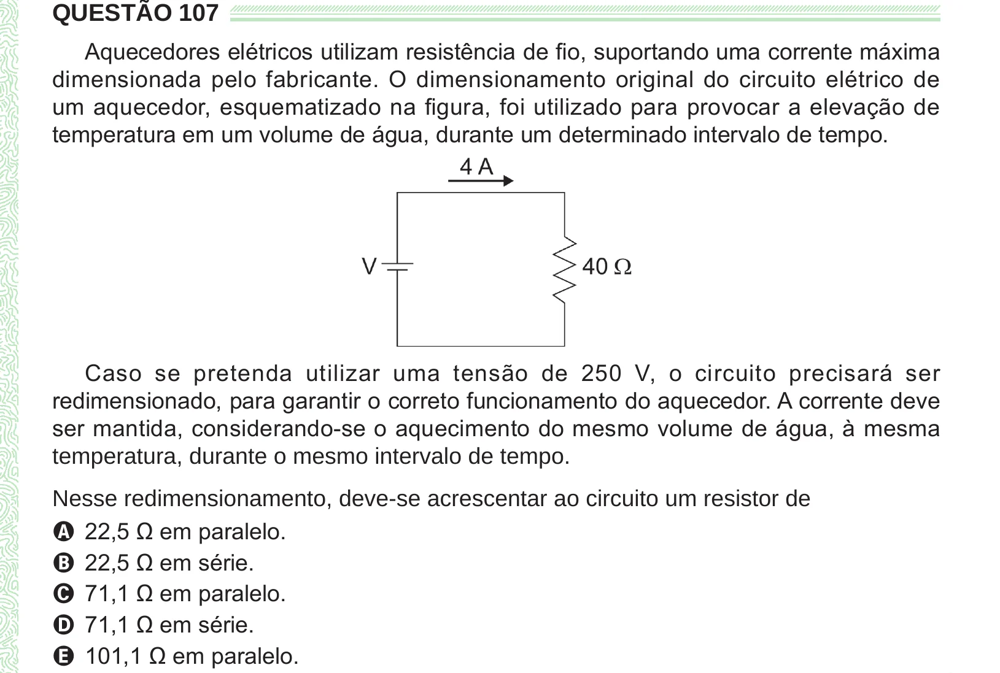

Texto extraído (pode conter ruído)

QUESTÃO 107  
Aquecedores elétricos utilizam resistência de fio, suportando uma corrente máxima  
dimensionada pelo fabricante. O dimensionamento original do circuito elétrico de  
um aquecedor, esquematizado na figura, foi utilizado para provocar a elevação de  
temperatura em um volume de água, durante um determinado intervalo de tempo.  
Caso se pretenda utilizar uma tensão de 250 V, o circuito precisará ser  
redimensionado, para garantir o correto funcionamento do aquecedor. A corrente deve  
ser mantida, considerando-se o aquecimento do mesmo volume de água, à mesma  
temperatura, durante o mesmo intervalo de tempo.  
Nesse redimensionamento, deve-se acrescentar ao circuito um resistor de  
A 22,5 Ω em paralelo.  
B 22,5 Ω em série.  
C 71,1 Ω em paralelo.  
D 71,1 Ω em série.  
E 101,1 Ω em paralelo.

