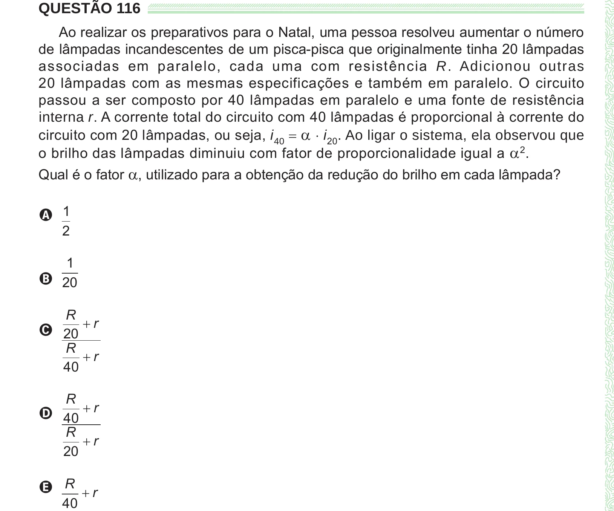

Texto extraído (pode conter ruído)

QUESTÃO 116  
Ao realizar os preparativos para o Natal, uma pessoa resolveu aumentar o número  
de lâmpadas incandescentes de um pisca-pisca que originalmente tinha 20 lâmpadas  
associadas em paralelo, cada uma com resistência R. Adicionou outras  
20 lâmpadas com as mesmas especificações e também em paralelo. O circuito  
passou a ser composto por 40 lâmpadas em paralelo e uma fonte de resistência  
interna r. A corrente total do circuito com 40 lâmpadas é proporcional à corrente do  
circuito com 20 lâmpadas, ou seja, i 40 = a ⋅ i 20 . Ao ligar o sistema, ela observou que  
o brilho das lâmpadas diminuiu com fator de proporcionalidade igual a a 2 .  
Qual é o fator a , utilizado para a obtenção da redução do brilho em cada lâmpada?  
A 1  
2  
1  
B 20  
R  
C 20 + r  
R  
+ r  
40  
R  
D 40 + r  
R  
+ r  
20  
E R + r  
40

