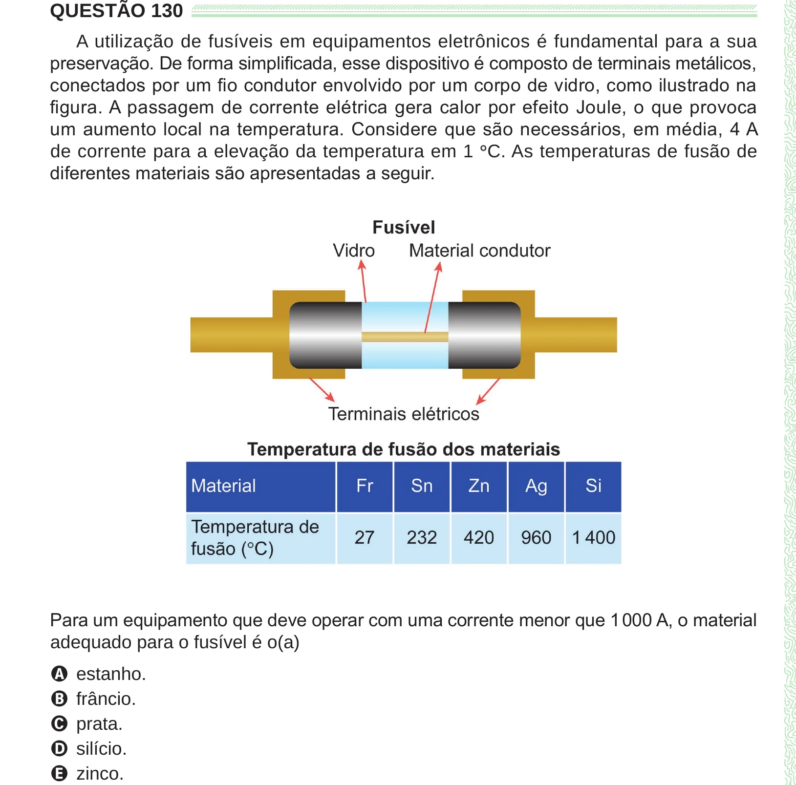

Texto extraído (pode conter ruído)

QUESTÃO 130  
A utilização de fusíveis em equipamentos eletrônicos é fundamental para a sua  
preservação. De forma simplificada, esse dispositivo é composto de terminais metálicos,  
conectados por um fio condutor envolvido por um corpo de vidro, como ilustrado na  
figura. A passagem de corrente elétrica gera calor por efeito Joule, o que provoca  
um aumento local na temperatura. Considere que são necessários, em média, 4 A  
de corrente para a elevação da temperatura em 1 ° C. As temperaturas de fusão de  
diferentes materiais são apresentadas a seguir.  
Para um equipamento que deve operar com uma corrente menor que 1 000 A, o material  
adequado para o fusível é o(a)  
A estanho.  
B frâncio.  
C prata.  
D silício.  
E zinco.

