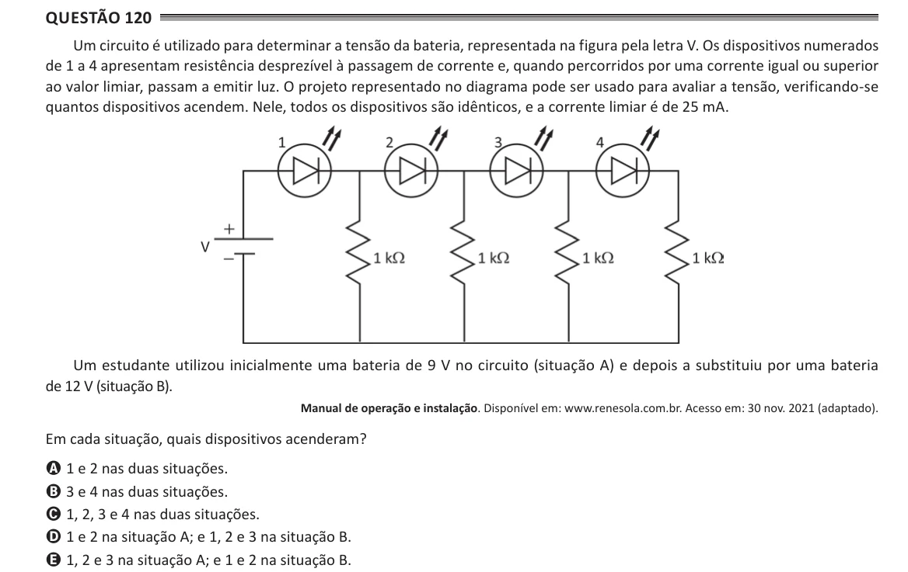

Texto extraído (pode conter ruído)

Questão 120  
Um circuito é utilizado para determinar a tensão da bateria, representada na figura pela letra V. Os dispositivos numerados  
de 1 a 4 apresentam resistência desprezível à passagem de corrente e, quando percorridos por uma corrente igual ou superior  
ao valor limiar, passam a emitir luz. O projeto representado no diagrama pode ser usado para avaliar a tensão, verificando-se  
quantos dispositivos acendem. Nele, todos os dispositivos são idênticos, e a corrente limiar é de 25 mA.  
Um estudante utilizou inicialmente uma bateria de 9 V no circuito (situação A) e depois a substituiu por uma bateria  
de 12 V (situação B).  
Manual de operação e instalação. Disponível em: www.renesola.com.br. Acesso em: 30 nov. 2021 (adaptado).  
Em cada situação, quais dispositivos acenderam?  
A 1 e 2 nas duas situações.  
B 3 e 4 nas duas situações.  
C 1, 2, 3 e 4 nas duas situações.  
D 1 e 2 na situação A; e 1, 2 e 3 na situação B.  
E 1, 2 e 3 na situação A; e 1 e 2 na situação B.

