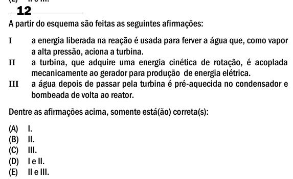

Texto extraído (pode conter ruído)

12  
A partir do esquema são feitas as seguintes afirmações:  
a energia liberada na reação é usada para ferver a água que, como vapor  
I  
a alta pressão, aciona a turbina.  
a turbina, que adquire uma energia cinética de rotação, é acoplada  
II  
mecanicamente ao gerador para produção de energia elétrica.  
a água depois de passar pela turbina é pré-aquecida no condensador e  
III  
bombeada de volta ao reator.  
Dentre as afirmações acima, somente está(ão) correta(s):  
(A)  
I.  
(B)  
II.  
(C)  
III.  
(D)  
I e II.  
(E)  
II e III.

