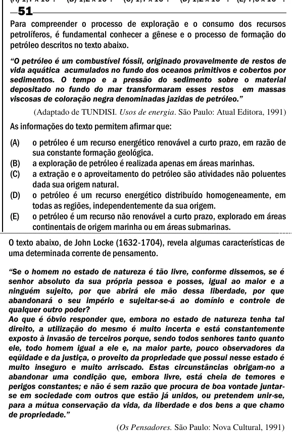

Texto extraído (pode conter ruído)

51  
Para compreender o processo de exploração e o consumo dos recursos  
petrolíferos, é fundamental conhecer a gênese e o processo de formação do  
petróleo descritos no texto abaixo.  
―O petróleo é um combustível fóssil, originado provavelmente de restos de  
vida aquática acumulados no fundo dos oceanos primitivos e cobertos por  
sedimentos. O tempo e a pressão do sedimento sobre o material  
depositado no fundo do mar transformaram esses restos em massas  
viscosas de coloração negra denominadas jazidas de petróleo.‖  
(Adaptado de TUNDISI. Usos de energia. São Paulo: Atual Editora, 1991)  
As informações do texto permitem afirmar que:  
(A)  
o petróleo é um recurso energético renovável a curto prazo, em razão de  
sua constante formação geológica.  
(B)  
a exploração de petróleo é realizada apenas em áreas marinhas.  
(C)  
a extração e o aproveitamento do petróleo são atividades não poluentes  
dada sua origem natural.  
(D)  
o petróleo é um recurso energético distribuído homogeneamente, em  
todas as regiões, independentemente da sua origem.  
(E)  
o petróleo é um recurso não renovável a curto prazo, explorado em áreas  
continentais de origem marinha ou em áreas submarinas.  
O texto abaixo, de John Locke (1632-1704), revela algumas características de  
uma determinada corrente de pensamento.  
―Se o homem no estado de natureza é tão livre, conforme dissemos, se é  
senhor absoluto da sua própria pessoa e posses, igual ao maior e a  
ninguém sujeito, por que abrirá ele mão dessa liberdade, por que  
abandonará o seu império e sujeitar-se-á ao domínio e controle de  
qualquer outro poder?  
Ao que é óbvio responder que, embora no estado de natureza tenha tal  
direito, a utilização do mesmo é muito incerta e está constantemente  
exposto à invasão de terceiros porque, sendo todos senhores tanto quanto  
ele, todo homem igual a ele e, na maior parte, pouco observadores da  
eqüidade e da justiça, o proveito da propriedade que possui nesse estado é  
muito inseguro e muito arriscado. Estas circunstâncias obrigam-no a  
abandonar uma condição que, embora livre, está cheia de temores e  
perigos constantes; e não é sem razão que procura de boa vontade juntar-  
se em sociedade com outros que estão já unidos, ou pretendem unir-se,  
para a mútua conservação da vida, da liberdade e dos bens a que chamo  
de propriedade.‖  
(Os Pensadores. São Paulo: Nova Cultural, 1991)

