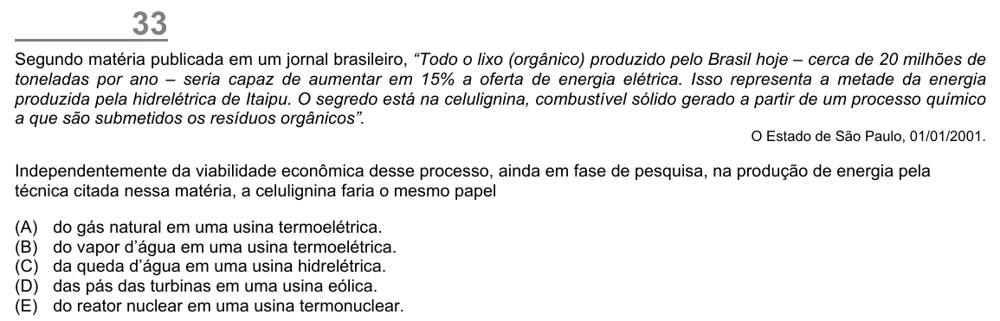

Texto extraído (pode conter ruído)

33  
Segundo matéria publicada em um jornal brasileiro, “Todo o lixo (orgânico) produzido pelo Brasil hoje – cerca de 20 milhões de  
toneladas por ano – seria capaz de aumentar em 15% a oferta de energia elétrica. Isso representa a metade da energia  
produzida pela hidrelétrica de Itaipu. O segredo está na celulignina, combustível sólido gerado a partir de um processo químico  
a que são submetidos os resíduos orgânicos”.  
O Estado de São Paulo, 01/01/2001.  
Independentemente da viabilidade econômica desse processo, ainda em fase de pesquisa, na produção de energia pela  
técnica citada nessa matéria, a celulignina faria o mesmo papel  
(A)  
do gás natural em uma usina termoelétrica.  
(B)  
do vapor d’água em uma usina termoelétrica.  
(C)  
da queda d’água em uma usina hidrelétrica.  
(D)  
das pás das turbinas em uma usina eólica.  
(E)  
do reator nuclear em uma usina termonuclear.

