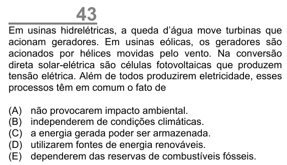

Texto extraído (pode conter ruído)

43  
Em usinas hidrelétricas, a queda d’água move turbinas que  
acionam geradores. Em usinas eólicas, os geradores são  
acionados por hélices movidas pelo vento. Na conversão  
direta solar-elétrica são células fotovoltaicas que produzem  
tensão elétrica. Além de todos produzirem eletricidade, esses  
processos têm em comum o fato de  
(A)  
não provocarem impacto ambiental.  
(B)  
independerem de condições climáticas.  
(C)  
a energia gerada poder ser armazenada.  
(D)  
utilizarem fontes de energia renováveis.  
(E)  
dependerem das reservas de combustíveis fósseis.

