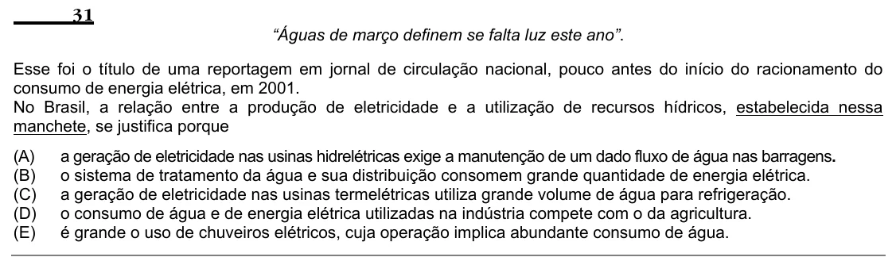

Texto extraído (pode conter ruído)

31  
“Águas de março definem se falta luz este ano”.  
Esse foi o título de uma reportagem em jornal de circulação nacional, pouco antes do início do racionamento do  
consumo de energia elétrica, em 2001.  
No Brasil, a relação entre a produção de eletricidade e a utilização de recursos hídricos, estabelecida nessa  
manchete, se justifica porque  
(A)  
a geração de eletricidade nas usinas hidrelétricas exige a manutenção de um dado fluxo de água nas barragens.  
(B)  
o sistema de tratamento da água e sua distribuição consomem grande quantidade de energia elétrica.  
(C)  
a geração de eletricidade nas usinas termelétricas utiliza grande volume de água para refrigeração.  
(D)  
o consumo de água e de energia elétrica utilizadas na indústria compete com o da agricultura.  
(E)  
é grande o uso de chuveiros elétricos, cuja operação implica abundante consumo de água.

