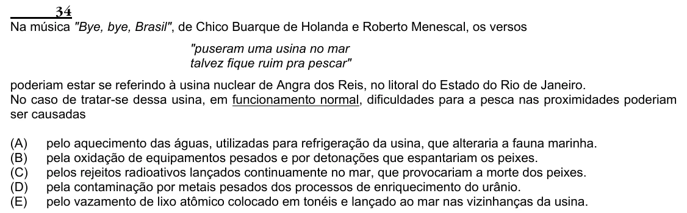

Texto extraído (pode conter ruído)

34  
Na música "Bye, bye, Brasil", de Chico Buarque de Holanda e Roberto Menescal, os versos  
"puseram uma usina no mar  
talvez fique ruim pra pescar"  
poderiam estar se referindo à usina nuclear de Angra dos Reis, no litoral do Estado do Rio de Janeiro.  
No caso de tratar-se dessa usina, em funcionamento normal, dificuldades para a pesca nas proximidades poderiam  
ser causadas  
(A)  
pelo aquecimento das águas, utilizadas para refrigeração da usina, que alteraria a fauna marinha.  
(B)  
pela oxidação de equipamentos pesados e por detonações que espantariam os peixes.  
(C)  
pelos rejeitos radioativos lançados continuamente no mar, que provocariam a morte dos peixes.  
(D)  
pela contaminação por metais pesados dos processos de enriquecimento do urânio.  
(E)  
pelo vazamento de lixo atômico colocado em tonéis e lançado ao mar nas vizinhanças da usina.

