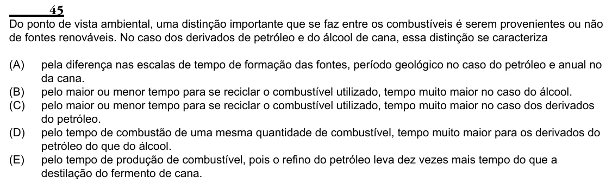

Texto extraído (pode conter ruído)

45  
Do ponto de vista ambiental, uma distinção importante que se faz entre os combustíveis é serem provenientes ou não  
de fontes renováveis. No caso dos derivados de petróleo e do álcool de cana, essa distinção se caracteriza  
(A)  
pela diferença nas escalas de tempo de formação das fontes, período geológico no caso do petróleo e anual no  
da cana.  
(B)  
pelo maior ou menor tempo para se reciclar o combustível utilizado, tempo muito maior no caso do álcool.  
(C)  
pelo maior ou menor tempo para se reciclar o combustível utilizado, tempo muito maior no caso dos derivados  
do petróleo.  
(D)  
pelo tempo de combustão de uma mesma quantidade de combustível, tempo muito maior para os derivados do  
petróleo do que do álcool.  
(E)  
pelo tempo de produção de combustível, pois o refino do petróleo leva dez vezes mais tempo do que a  
destilação do fermento de cana.

