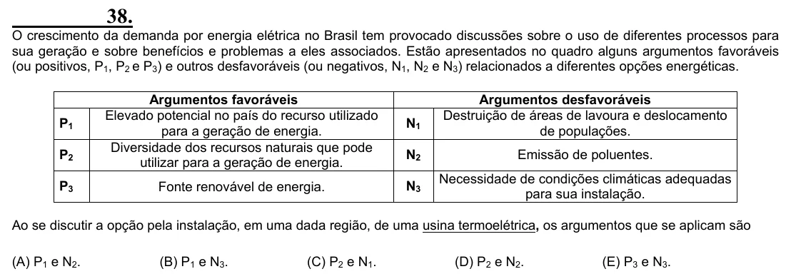

Texto extraído (pode conter ruído)

38.  
O crescimento da demanda por energia elétrica no Brasil tem provocado discussões sobre o uso de diferentes processos para  
sua geração e sobre benefícios e problemas a eles associados. Estão apresentados no quadro alguns argumentos favoráveis  
(ou positivos, P 1 , P 2 e P 3 ) e outros desfavoráveis (ou negativos, N 1 , N 2 e N 3 ) relacionados a diferentes opções energéticas.  
Argumentos favoráveis  
Argumentos desfavoráveis  
Elevado potencial no país do recurso utilizado  
Destruição de áreas de lavoura e deslocamento  
P 1  
N 1  
para a geração de energia.  
de populações.  
Diversidade dos recursos naturais que pode  
P 2  
N 2  
Emissão de poluentes.  
utilizar para a geração de energia.  
Necessidade de condições climáticas adequadas  
P 3  
Fonte renovável de energia.  
N 3  
para sua instalação.  
Ao se discutir a opção pela instalação, em uma dada região, de uma usina termoelétrica, os argumentos que se aplicam são  
(A) P 1 e N 2 .  
(B) P 1 e N 3 .  
(C) P 2 e N 1 .  
(D) P 2 e N 2 .  
(E) P 3 e N 3 .

