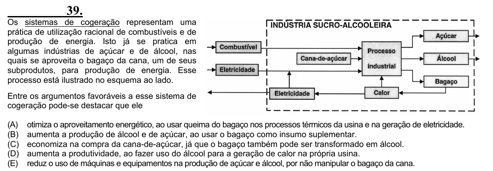

Texto extraído (pode conter ruído)

39.  
Os sistemas de cogeração representam uma  
prática de utilização racional de combustíveis e de  
produção de energia. Isto já se pratica em  
algumas indústrias de açúcar e de álcool, nas  
quais se aproveita o bagaço da cana, um de seus  
subprodutos, para produção de energia. Esse  
processo está ilustrado no esquema ao lado.  
Entre os argumentos favoráveis a esse sistema de  
cogeração pode-se destacar que ele  
(A)  
otimiza o aproveitamento energético, ao usar queima do bagaço nos processos térmicos da usina e na geração de eletricidade.  
(B)  
aumenta a produção de álcool e de açúcar, ao usar o bagaço como insumo suplementar.  
(C)  
economiza na compra da cana-de-açúcar, já que o bagaço também pode ser transformado em álcool.  
(D)  
aumenta a produtividade, ao fazer uso do álcool para a geração de calor na própria usina.  
(E)  
reduz o uso de máquinas e equipamentos na produção de açúcar e álcool, por não manipular o bagaço da cana.

