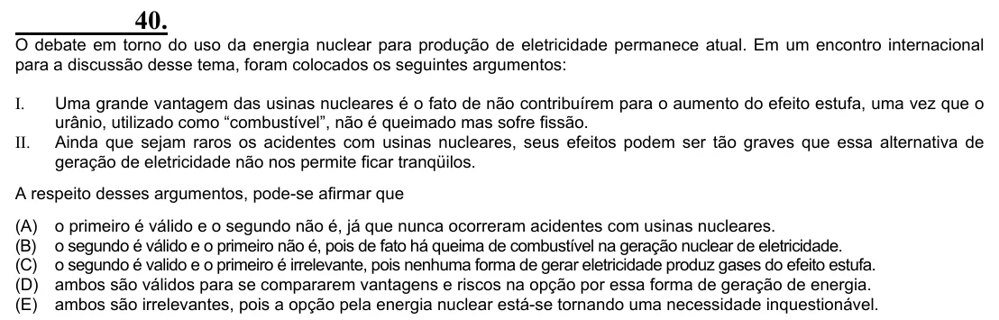

Texto extraído (pode conter ruído)

40.  
O debate em torno do uso da energia nuclear para produção de eletricidade permanece atual. Em um encontro internacional  
para a discussão desse tema, foram colocados os seguintes argumentos:  
I.  
Uma grande vantagem das usinas nucleares é o fato de não contribuírem para o aumento do efeito estufa, uma vez que o  
urânio, utilizado como “combustível”, não é queimado mas sofre fissão.  
II.  
Ainda que sejam raros os acidentes com usinas nucleares, seus efeitos podem ser tão graves que essa alternativa de  
geração de eletricidade não nos permite ficar tranqüilos.  
A respeito desses argumentos, pode-se afirmar que  
(A)  
o primeiro é válido e o segundo não é, já que nunca ocorreram acidentes com usinas nucleares.  
(B)  
o segundo é válido e o primeiro não é, pois de fato há queima de combustível na geração nuclear de eletricidade.  
(C)  
o segundo é valido e o primeiro é irrelevante, pois nenhuma forma de gerar eletricidade produz gases do efeito estufa.  
(D)  
ambos são válidos para se compararem vantagens e riscos na opção por essa forma de geração de energia.  
(E)  
ambos são irrelevantes, pois a opção pela energia nuclear está-se tornando uma necessidade inquestionável.

