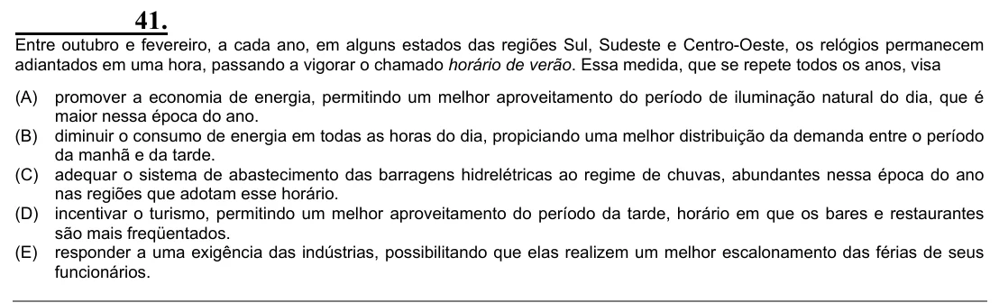

Texto extraído (pode conter ruído)

41.  
Entre outubro e fevereiro, a cada ano, em alguns estados das regiões Sul, Sudeste e Centro-Oeste, os relógios permanecem  
adiantados em uma hora, passando a vigorar o chamado horário de verão. Essa medida, que se repete todos os anos, visa  
(A)  
promover a economia de energia, permitindo um melhor aproveitamento do período de iluminação natural do dia, que é  
maior nessa época do ano.  
(B) diminuir o consumo de energia em todas as horas do dia, propiciando uma melhor distribuição da demanda entre o período  
da manhã e da tarde.  
(C) adequar o sistema de abastecimento das barragens hidrelétricas ao regime de chuvas, abundantes nessa época do ano  
nas regiões que adotam esse horário.  
(D) incentivar o turismo, permitindo um melhor aproveitamento do período da tarde, horário em que os bares e restaurantes  
são mais freqüentados.  
(E) responder a uma exigência das indústrias, possibilitando que elas realizem um melhor escalonamento das férias de seus  
funcionários.

