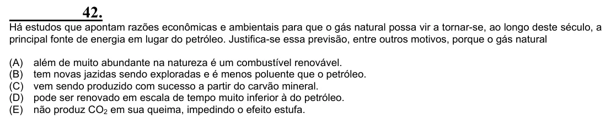

Texto extraído (pode conter ruído)

42.  
Há estudos que apontam razões econômicas e ambientais para que o gás natural possa vir a tornar-se, ao longo deste século, a  
principal fonte de energia em lugar do petróleo. Justifica-se essa previsão, entre outros motivos, porque o gás natural  
(A)  
além de muito abundante na natureza é um combustível renovável.  
(B)  
tem novas jazidas sendo exploradas e é menos poluente que o petróleo.  
(C)  
vem sendo produzido com sucesso a partir do carvão mineral.  
(D)  
pode ser renovado em escala de tempo muito inferior à do petróleo.  
(E)  
não produz CO 2 em sua queima, impedindo o efeito estufa.

