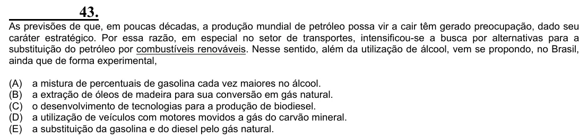

Texto extraído (pode conter ruído)

43.  
As previsões de que, em poucas décadas, a produção mundial de petróleo possa vir a cair têm gerado preocupação, dado seu  
caráter estratégico. Por essa razão, em especial no setor de transportes, intensificou-se a busca por alternativas para a  
substituição do petróleo por combustíveis renováveis. Nesse sentido, além da utilização de álcool, vem se propondo, no Brasil,  
ainda que de forma experimental,  
(A)  
a mistura de percentuais de gasolina cada vez maiores no álcool.  
(B)  
a extração de óleos de madeira para sua conversão em gás natural.  
(C)  
o desenvolvimento de tecnologias para a produção de biodiesel.  
(D)  
a utilização de veículos com motores movidos a gás do carvão mineral.  
(E)  
a substituição da gasolina e do diesel pelo gás natural.

