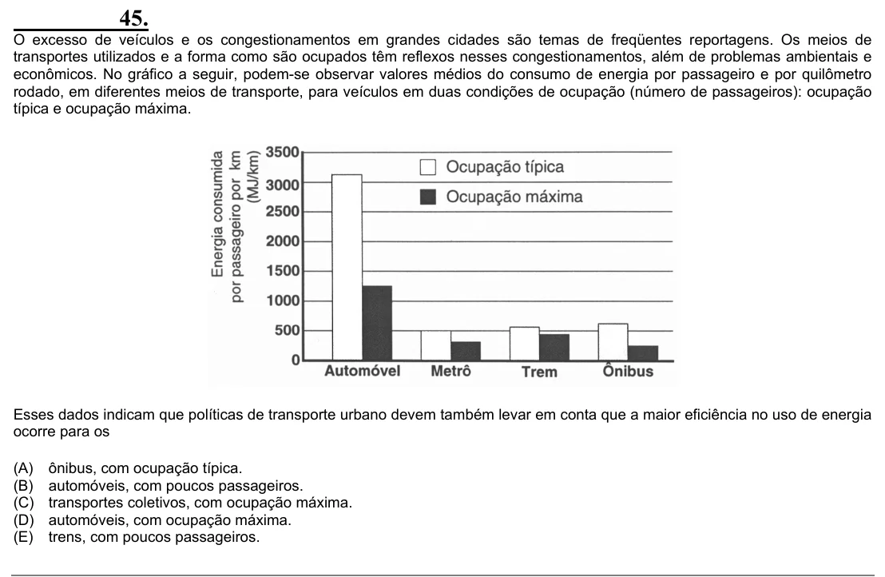

Texto extraído (pode conter ruído)

45.  
O excesso de veículos e os congestionamentos em grandes cidades são temas de freqüentes reportagens. Os meios de  
transportes utilizados e a forma como são ocupados têm reflexos nesses congestionamentos, além de problemas ambientais e  
econômicos. No gráfico a seguir, podem-se observar valores médios do consumo de energia por passageiro e por quilômetro  
rodado, em diferentes meios de transporte, para veículos em duas condições de ocupação (número de passageiros): ocupação  
típica e ocupação máxima.  
Esses dados indicam que políticas de transporte urbano devem também levar em conta que a maior eficiência no uso de energia  
ocorre para os  
(A)  
ônibus, com ocupação típica.  
(B)  
automóveis, com poucos passageiros.  
(C)  
transportes coletivos, com ocupação máxima.  
(D)  
automóveis, com ocupação máxima.  
(E)  
trens, com poucos passageiros.

