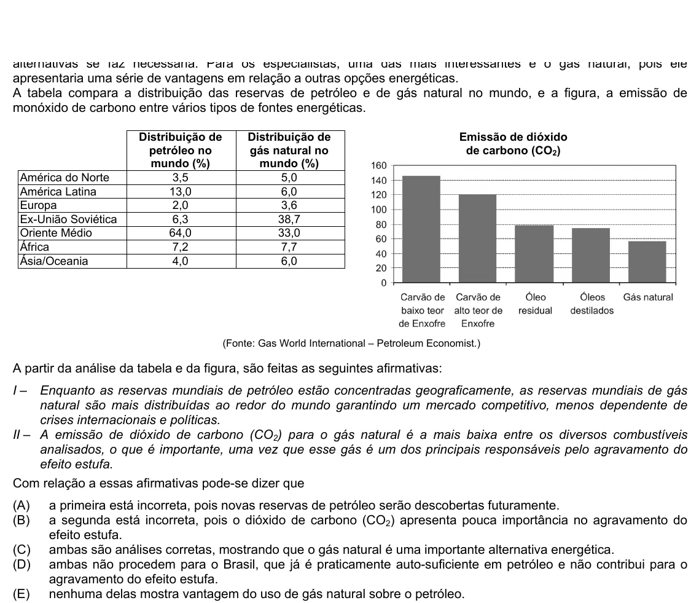

Texto extraído (pode conter ruído)

apresentaria uma série de vantagens em relação a outras opções energéticas.  
A tabela compara a distribuição das reservas de petróleo e de gás natural no mundo, e a figura, a emissão de  
monóxido de carbono entre vários tipos de fontes energéticas.  
Distribuição de  
Distribuição de  
Emissão de dióxido  
petróleo no  
gás natural no  
de carbono (CO 2 )  
mundo (%)  
mundo (%)  
América do Norte  
3,5  
5,0  
América Latina  
13,0  
6,0  
Europa  
2,0  
3,6  
Ex-União Soviética  
6,3  
38,7  
Oriente Médio  
64,0  
33,0  
África  
7,2  
7,7  
Ásia/Oceania  
4,0  
6,0  
(Fonte: Gas World International – Petroleum Economist.)  
A partir da análise da tabela e da figura, são feitas as seguintes afirmativas:  
I –  
Enquanto as reservas mundiais de petróleo estão concentradas geograficamente, as reservas mundiais de gás  
natural são mais distribuídas ao redor do mundo garantindo um mercado competitivo, menos dependente de  
crises internacionais e políticas.  
II – A emissão de dióxido de carbono (CO 2 ) para o gás natural é a mais baixa entre os diversos combustíveis  
analisados, o que é importante, uma vez que esse gás é um dos principais responsáveis pelo agravamento do  
efeito estufa.  
Com relação a essas afirmativas pode-se dizer que  
(A)  
a primeira está incorreta, pois novas reservas de petróleo serão descobertas futuramente.  
(B)  
a segunda está incorreta, pois o dióxido de carbono (CO 2 ) apresenta pouca importância no agravamento do  
efeito estufa.  
(C)  
ambas são análises corretas, mostrando que o gás natural é uma importante alternativa energética.  
(D)  
ambas não procedem para o Brasil, que já é praticamente auto-suficiente em petróleo e não contribui para o  
agravamento do efeito estufa.  
(E)  
nenhuma delas mostra vantagem do uso de gás natural sobre o petróleo.

