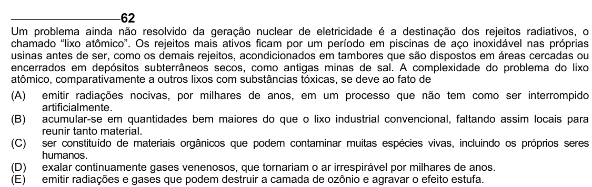

Texto extraído (pode conter ruído)

62  
Um problema ainda não resolvido da geração nuclear de eletricidade é a destinação dos rejeitos radiativos, o  
chamado “lixo atômico”. Os rejeitos mais ativos ficam por um período em piscinas de aço inoxidável nas próprias  
usinas antes de ser, como os demais rejeitos, acondicionados em tambores que são dispostos em áreas cercadas ou  
encerrados em depósitos subterrâneos secos, como antigas minas de sal. A complexidade do problema do lixo  
atômico, comparativamente a outros lixos com substâncias tóxicas, se deve ao fato de  
(A)  
emitir radiações nocivas, por milhares de anos, em um processo que não tem como ser interrompido  
artificialmente.  
(B)  
acumular-se em quantidades bem maiores do que o lixo industrial convencional, faltando assim locais para  
reunir tanto material.  
(C) ser constituído de materiais orgânicos que podem contaminar muitas espécies vivas, incluindo os próprios seres  
humanos.  
(D) exalar continuamente gases venenosos, que tornariam o ar irrespirável por milhares de anos.  
(E)  
emitir radiações e gases que podem destruir a camada de ozônio e agravar o efeito estufa.

