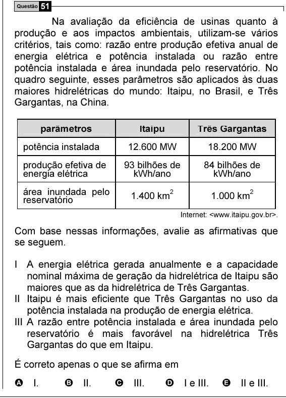

Texto extraído (pode conter ruído)

Questão 51  
Na avaliação da eficiência de usinas quanto à  
produção e aos impactos ambientais, utilizam-se vários  
critérios, tais como: razão entre produção efetiva anual de  
energia elétrica e potência instalada ou razão entre  
potência instalada e área inundada pelo reservatório. No  
quadro seguinte, esses parâmetros são aplicados às duas  
maiores hidrelétricas do mundo: Itaipu, no Brasil, e Três  
Gargantas, na China.  
parâmetros  
Itaipu  
Três Gargantas  
potência instalada  
12.600 MW  
18.200 MW  
produção efetiva de  
93 bilhões de  
84 bilhões de  
energia elétrica  
kWh/ano  
kWh/ano  
área inundada pelo  
2  
2  
1.400 km  
1.000 km  
reservatório  
Internet: <www.itaipu.gov.br>.  
Com base nessas informações, avalie as afirmativas que  
se seguem.  
I A energia elétrica gerada anualmente e a capacidade  
nominal máxima de geração da hidrelétrica de Itaipu são  
maiores que as da hidrelétrica de Três Gargantas.  
II Itaipu é mais eficiente que Três Gargantas no uso da  
potência instalada na produção de energia elétrica.  
III A razão entre potência instalada e área inundada pelo  
reservatório é mais favorável na hidrelétrica Três  
Gargantas do que em Itaipu.  
É correto apenas o que se afirma em  
A I.  
B II.  
C III.  
D I e III.  
E II e III.

