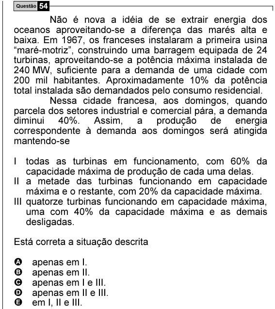

Texto extraído (pode conter ruído)

Questão 54  
Não é nova a idéia de se extrair energia dos  
oceanos aproveitando-se a diferença das marés alta e  
baixa. Em 1967, os franceses instalaram a primeira usina  
“maré-motriz”, construindo uma barragem equipada de 24  
turbinas, aproveitando-se a potência máxima instalada de  
240 MW, suficiente para a demanda de uma cidade com  
200 mil habitantes. Aproximadamente 10% da potência  
total instalada são demandados pelo consumo residencial.  
Nessa cidade francesa, aos domingos, quando  
parcela dos setores industrial e comercial pára, a demanda  
diminui 40%. Assim, a produção de energia  
correspondente à demanda aos domingos será atingida  
mantendo-se  
I todas as turbinas em funcionamento, com 60% da  
capacidade máxima de produção de cada uma delas.  
II a metade das turbinas funcionando em capacidade  
máxima e o restante, com 20% da capacidade máxima.  
III quatorze turbinas funcionando em capacidade máxima,  
uma com 40% da capacidade máxima e as demais  
desligadas.  
Está correta a situação descrita  
A  
apenas em I.  
B  
apenas em II.  
C  
apenas em I e III.  
D  
apenas em II e III.  
E  
em I, II e III.

