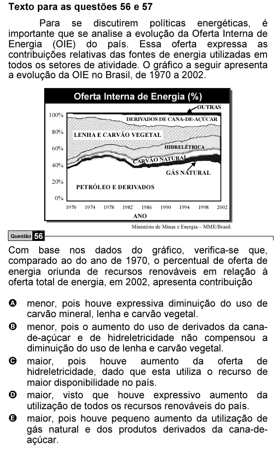

Texto extraído (pode conter ruído)

Texto para as questões 56 e 57  
Para se discutirem políticas energéticas, é  
importante que se analise a evolução da Oferta Interna de  
Energia (OIE) do país. Essa oferta expressa as  
contribuições relativas das fontes de energia utilizadas em  
todos os setores de atividade. O gráfico a seguir apresenta  
a evolução da OIE no Brasil, de 1970 a 2002.  
Oferta Interna de Energia (%)  
OUTRAS  
100%  
DERIVADOS DE CANA-DE-AÇÚCAR  
80%  
LENHA E CARVÃO VEGETAL  
60%  
HIDRELÉTRICA  
CARVÃO NA  
TURAL  
40%  
GÁS NATURAL  
20%  
PETRÓLEO E DERIVADOS  
0%  
1970  
1974  
1978  
1982  
1986  
1990  
1994  
1998  
2002  
ANO  
Ministério de Minas e Energia – MME/Brasil.  
Questão 56  
Com base nos dados do gráfico, verifica-se que,  
comparado ao do ano de 1970, o percentual de oferta de  
energia oriunda de recursos renováveis em relação à  
oferta total de energia, em 2002, apresenta contribuição  
A menor, pois houve expressiva diminuição do uso de  
carvão mineral, lenha e carvão vegetal.  
B menor, pois o aumento do uso de derivados da cana-  
de-açúcar e de hidreletricidade não compensou a  
diminuição do uso de lenha e carvão vegetal.  
C maior, pois houve aumento da oferta de  
hidreletricidade, dado que esta utiliza o recurso de  
maior disponibilidade no país.  
D maior, visto que houve expressivo aumento da  
utilização de todos os recursos renováveis do país.  
E maior, pois houve pequeno aumento da utilização de  
gás natural e dos produtos derivados da cana-de-  
açúcar.

