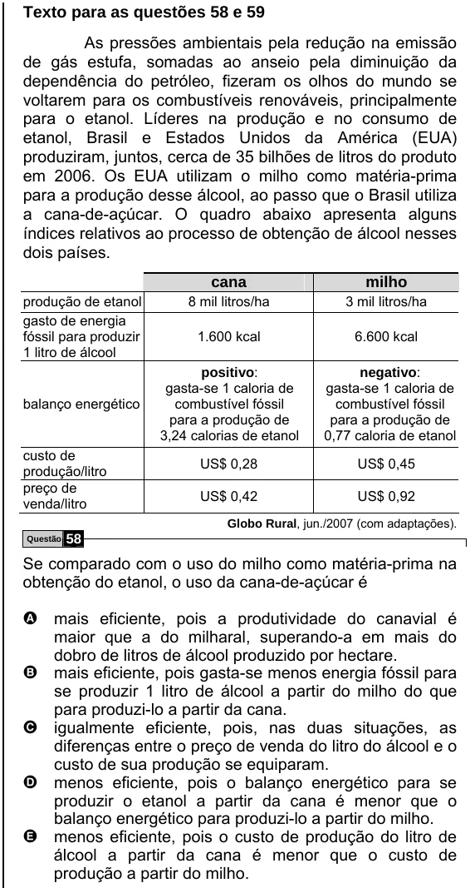

Texto extraído (pode conter ruído)

Texto para as questões 58 e 59  
As pressões ambientais pela redução na emissão  
de gás estufa, somadas ao anseio pela diminuição da  
dependência do petróleo, fizeram os olhos do mundo se  
voltarem para os combustíveis renováveis, principalmente  
para o etanol. Líderes na produção e no consumo de  
etanol, Brasil e Estados Unidos da América (EUA)  
produziram, juntos, cerca de 35 bilhões de litros do produto  
em 2006. Os EUA utilizam o milho como matéria-prima  
para a produção desse álcool, ao passo que o Brasil utiliza  
a cana-de-açúcar. O quadro abaixo apresenta alguns  
índices relativos ao processo de obtenção de álcool nesses  
dois países.  
cana  
milho  
produção de etanol  
8 mil litros/ha  
3 mil litros/ha  
gasto de energia  
fóssil para produzir  
1.600 kcal  
6.600 kcal  
1 litro de álcool  
positivo:  
negativo:  
gasta-se 1 caloria de  
gasta-se 1 caloria de  
balanço energético  
combustível fóssil  
combustível fóssil  
para a produção de  
para a produção de  
3,24 calorias de etanol  
0,77 caloria de etanol  
custo de  
US$ 0,28  
US$ 0,45  
produção/litro  
preço de  
US$ 0,42  
US$ 0,92  
venda/litro  
Globo Rural, jun./2007 (com adaptações).  
58  
Questão  
Se comparado com o uso do milho como matéria-prima na  
obtenção do etanol, o uso da cana-de-açúcar é  
A mais eficiente, pois a produtividade do canavial é  
maior que a do milharal, superando-a em mais do  
dobro de litros de álcool produzido por hectare.  
mais eficiente, pois gasta-se menos energia fóssil para  
B  
se produzir 1 litro de álcool a partir do milho do que  
para produzi-lo a partir da cana.  
C  
igualmente eficiente, pois, nas duas situações, as  
diferenças entre o preço de venda do litro do álcool e o  
custo de sua produção se equiparam.  
menos eficiente, pois o balanço energético para se  
D  
produzir o etanol a partir da cana é menor que o  
balanço energético para produzi-lo a partir do milho.  
E  
menos eficiente, pois o custo de produção do litro de  
álcool a partir da cana é menor que o custo de  
produção a partir do milho.

