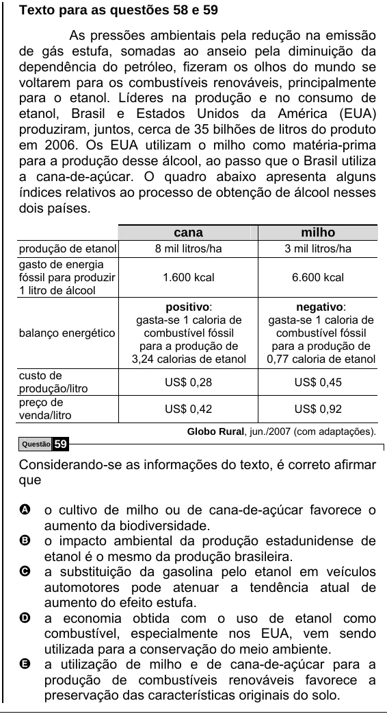

Texto extraído (pode conter ruído)

Texto para as questões 58 e 59  
As pressões ambientais pela redução na emissão  
de gás estufa, somadas ao anseio pela diminuição da  
dependência do petróleo, fizeram os olhos do mundo se  
voltarem para os combustíveis renováveis, principalmente  
para o etanol. Líderes na produção e no consumo de  
etanol, Brasil e Estados Unidos da América (EUA)  
produziram, juntos, cerca de 35 bilhões de litros do produto  
em 2006. Os EUA utilizam o milho como matéria-prima  
para a produção desse álcool, ao passo que o Brasil utiliza  
a cana-de-açúcar. O quadro abaixo apresenta alguns  
índices relativos ao processo de obtenção de álcool nesses  
dois países.  
cana  
milho  
produção de etanol  
8 mil litros/ha  
3 mil litros/ha  
gasto de energia  
fóssil para produzir  
1.600 kcal  
6.600 kcal  
1 litro de álcool  
positivo:  
negativo:  
gasta-se 1 caloria de  
gasta-se 1 caloria de  
balanço energético  
combustível fóssil  
combustível fóssil  
para a produção de  
para a produção de  
3,24 calorias de etanol  
0,77 caloria de etanol  
custo de  
US$ 0,28  
US$ 0,45  
produção/litro  
preço de  
US$ 0,42  
US$ 0,92  
venda/litro  
Globo Rural, jun./2007 (com adaptações).  
Questão  
59  
Considerando-se as informações do texto, é correto afirmar  
que  
A o cultivo de milho ou de cana-de-açúcar favorece o  
aumento da biodiversidade.  
B o impacto ambiental da produção estadunidense de  
etanol é o mesmo da produção brasileira.  
C a substituição da gasolina pelo etanol em veículos  
automotores pode atenuar a tendência atual de  
aumento do efeito estufa.  
D a economia obtida com o uso de etanol como  
combustível, especialmente nos EUA, vem sendo  
utilizada para a conservação do meio ambiente.  
E a utilização de milho e de cana-de-açúcar para a  
produção de combustíveis renováveis favorece a  
preservação das características originais do solo.

