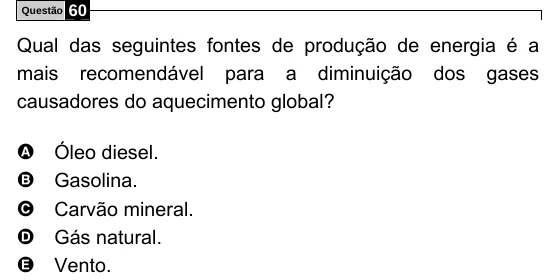

Texto extraído (pode conter ruído)

Questão  
60  
Qual das seguintes fontes de produção de energia é a  
mais recomendável para a diminuição dos gases  
causadores do aquecimento global?  
A  
Óleo diesel.  
B  
Gasolina.  
C  
Carvão mineral.  
D  
Gás natural.  
E  
Vento.

