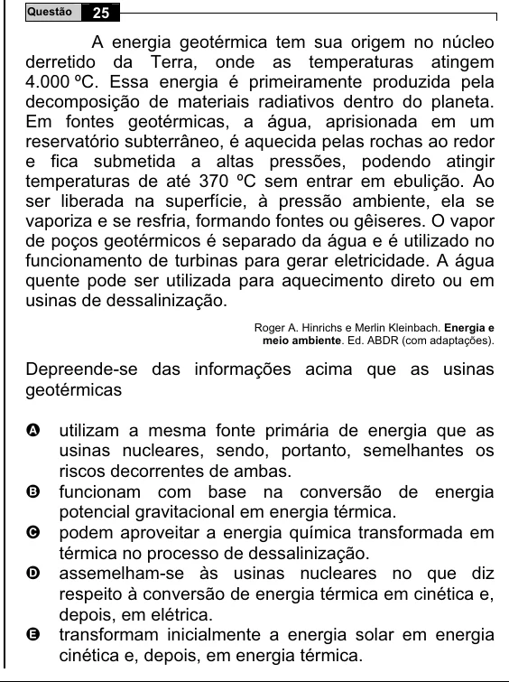

Texto extraído (pode conter ruído)

25  
Questão  
A energia geotérmica tem sua origem no núcleo  
derretido da Terra, onde as temperaturas atingem  
4.000 ºC. Essa energia é primeiramente produzida pela  
decomposição de materiais radiativos dentro do planeta.  
Em fontes geotérmicas, a água, aprisionada em um  
reservatório subterrâneo, é aquecida pelas rochas ao redor  
e fica submetida a altas pressões, podendo atingir  
temperaturas de até 370 ºC sem entrar em ebulição. Ao  
ser liberada na superfície, à pressão ambiente, ela se  
vaporiza e se resfria, formando fontes ou gêiseres. O vapor  
de poços geotérmicos é separado da água e é utilizado no  
funcionamento de turbinas para gerar eletricidade. A água  
quente pode ser utilizada para aquecimento direto ou em  
usinas de dessalinização.  
Roger A. Hinrichs e Merlin Kleinbach. Energia e  
meio ambiente. Ed. ABDR (com adaptações).  
Depreende-se das informações acima que as usinas  
geotérmicas  
utilizam a mesma fonte primária de energia que as  
A  
usinas nucleares, sendo, portanto, semelhantes os  
riscos decorrentes de ambas.  
B  
funcionam com base na conversão de energia  
potencial gravitacional em energia térmica.  
podem aproveitar a energia química transformada em  
C  
térmica no processo de dessalinização.  
assemelham-se às usinas nucleares no que diz  
D  
respeito à conversão de energia térmica em cinética e,  
depois, em elétrica.  
transformam inicialmente a energia solar em energia  
E  
cinética e, depois, em energia térmica.

