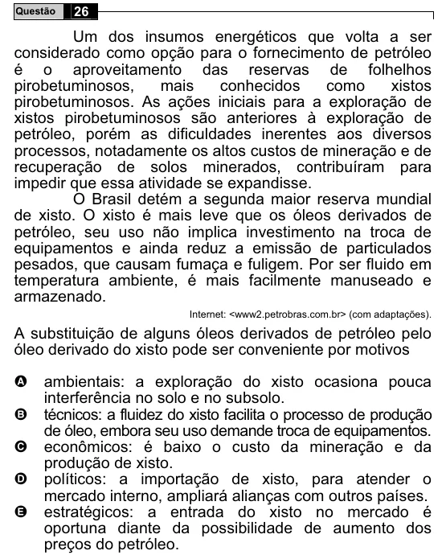

Texto extraído (pode conter ruído)

26  
Questão  
Um dos insumos energéticos que volta a ser  
considerado como opção para o fornecimento de petróleo  
é o aproveitamento das reservas de folhelhos  
pirobetuminosos,  
mais  
conhecidos  
como  
xistos  
pirobetuminosos. As ações iniciais para a exploração de  
xistos pirobetuminosos são anteriores à exploração de  
petróleo, porém as dificuldades inerentes aos diversos  
processos, notadamente os altos custos de mineração e de  
recuperação de solos minerados, contribuíram para  
impedir que essa atividade se expandisse.  
O Brasil detém a segunda maior reserva mundial  
de xisto. O xisto é mais leve que os óleos derivados de  
petróleo, seu uso não implica investimento na troca de  
equipamentos e ainda reduz a emissão de particulados  
pesados, que causam fumaça e fuligem. Por ser fluido em  
temperatura ambiente, é mais facilmente manuseado e  
armazenado.  
Internet: <www2.petrobras.com.br> (com adaptações).  
A substituição de alguns óleos derivados de petróleo pelo  
óleo derivado do xisto pode ser conveniente por motivos  
A  
ambientais: a exploração do xisto ocasiona pouca  
interferência no solo e no subsolo.  
técnicos: a fluidez do xisto facilita o processo de produção  
B  
de óleo, embora seu uso demande troca de equipamentos.  
C  
econômicos: é baixo o custo da mineração e da  
produção de xisto.  
políticos: a importação de xisto, para atender o  
D  
mercado interno, ampliará alianças com outros países.  
E  
estratégicos: a entrada do xisto no mercado é  
oportuna diante da possibilidade de aumento dos  
preços do petróleo.

