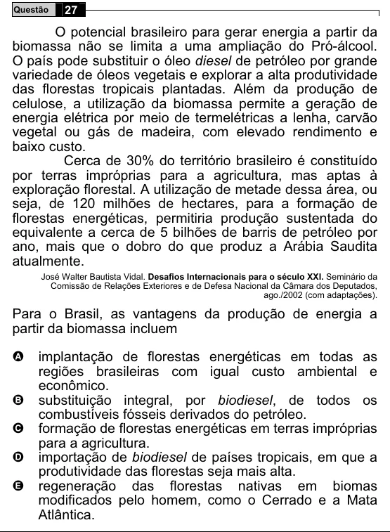

Texto extraído (pode conter ruído)

Questão  
27  
O potencial brasileiro para gerar energia a partir da  
biomassa não se limita a uma ampliação do Pró-álcool.  
O país pode substituir o óleo diesel de petróleo por grande  
variedade de óleos vegetais e explorar a alta produtividade  
das florestas tropicais plantadas. Além da produção de  
celulose, a utilização da biomassa permite a geração de  
energia elétrica por meio de termelétricas a lenha, carvão  
vegetal ou gás de madeira, com elevado rendimento e  
baixo custo.  
Cerca de 30% do território brasileiro é constituído  
por terras impróprias para a agricultura, mas aptas à  
exploração florestal. A utilização de metade dessa área, ou  
seja, de 120 milhões de hectares, para a formação de  
florestas energéticas, permitiria produção sustentada do  
equivalente a cerca de 5 bilhões de barris de petróleo por  
ano, mais que o dobro do que produz a Arábia Saudita  
atualmente.  
José Walter Bautista Vidal. Desafios Internacionais para o século XXI. Seminário da  
Comissão de Relações Exteriores e de Defesa Nacional da Câmara dos Deputados,  
ago./2002 (com adaptações).  
Para o Brasil, as vantagens da produção de energia a  
partir da biomassa incluem  
A  
implantação de florestas energéticas em todas as  
regiões brasileiras com igual custo ambiental e  
econômico.  
B  
substituição integral, por biodiesel, de todos os  
combustíveis fósseis derivados do petróleo.  
formação de florestas energéticas em terras impróprias  
C  
para a agricultura.  
D  
importação de biodiesel de países tropicais, em que a  
produtividade das florestas seja mais alta.  
regeneração das florestas nativas em biomas  
E  
modificados pelo homem, como o Cerrado e a Mata  
Atlântica.

