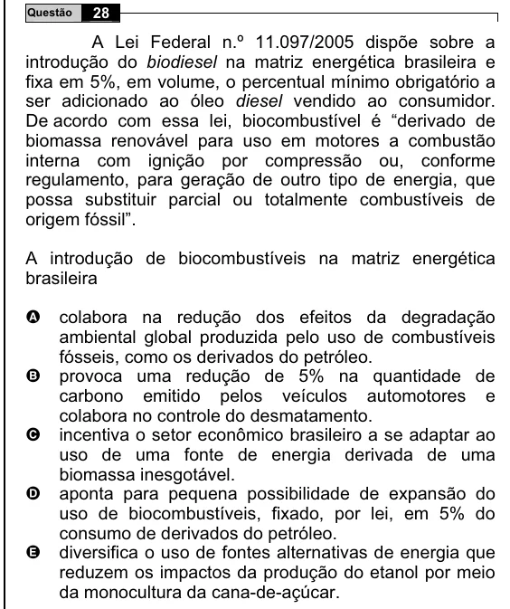

Texto extraído (pode conter ruído)

28  
Questão  
A Lei Federal n.º 11.097/2005 dispõe sobre a  
introdução do biodiesel na matriz energética brasileira e  
fixa em 5%, em volume, o percentual mínimo obrigatório a  
ser adicionado ao óleo diesel vendido ao consumidor.  
De acordo com essa lei, biocombustível é “derivado de  
biomassa renovável para uso em motores a combustão  
interna com ignição por compressão ou, conforme  
regulamento, para geração de outro tipo de energia, que  
possa substituir parcial ou totalmente combustíveis de  
origem fóssil”.  
A introdução de biocombustíveis na matriz energética  
brasileira  
A  
colabora na redução dos efeitos da degradação  
ambiental global produzida pelo uso de combustíveis  
fósseis, como os derivados do petróleo.  
provoca uma redução de 5% na quantidade de  
B  
carbono emitido pelos veículos automotores e  
colabora no controle do desmatamento.  
C  
incentiva o setor econômico brasileiro a se adaptar ao  
uso de uma fonte de energia derivada de uma  
biomassa inesgotável.  
aponta para pequena possibilidade de expansão do  
D  
uso de biocombustíveis, fixado, por lei, em 5% do  
consumo de derivados do petróleo.  
E  
diversifica o uso de fontes alternativas de energia que  
reduzem os impactos da produção do etanol por meio  
da monocultura da cana-de-açúcar.

