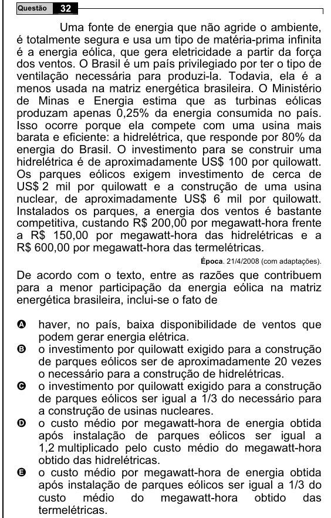

Texto extraído (pode conter ruído)

32  
Questão  
Uma fonte de energia que não agride o ambiente,  
é totalmente segura e usa um tipo de matéria-prima infinita  
é a energia eólica, que gera eletricidade a partir da força  
dos ventos. O Brasil é um país privilegiado por ter o tipo de  
ventilação necessária para produzi-la. Todavia, ela é a  
menos usada na matriz energética brasileira. O Ministério  
de Minas e Energia estima que as turbinas eólicas  
produzam apenas 0,25% da energia consumida no país.  
Isso ocorre porque ela compete com uma usina mais  
barata e eficiente: a hidrelétrica, que responde por 80% da  
energia do Brasil. O investimento para se construir uma  
hidrelétrica é de aproximadamente US$ 100 por quilowatt.  
Os parques eólicos exigem investimento de cerca de  
US$ 2 mil por quilowatt e a construção de uma usina  
nuclear, de aproximadamente US$ 6 mil por quilowatt.  
Instalados os parques, a energia dos ventos é bastante  
competitiva, custando R$ 200,00 por megawatt-hora frente  
a R$ 150,00 por megawatt-hora das hidrelétricas e a  
R$ 600,00 por megawatt-hora das termelétricas.  
Época. 21/4/2008 (com adaptações).  
De acordo com o texto, entre as razões que contribuem  
para a menor participação da energia eólica na matriz  
energética brasileira, inclui-se o fato de  
haver, no país, baixa disponibilidade de ventos que  
A  
podem gerar energia elétrica.  
B  
o investimento por quilowatt exigido para a construção  
de parques eólicos ser de aproximadamente 20 vezes  
o necessário para a construção de hidrelétricas.  
o investimento por quilowatt exigido para a construção  
C  
de parques eólicos ser igual a 1/3 do necessário para  
a construção de usinas nucleares.  
o custo médio por megawatt-hora de energia obtida  
D  
após instalação de parques eólicos ser igual a  
1,2 multiplicado pelo custo médio do megawatt-hora  
obtido das hidrelétricas.  
E  
o custo médio por megawatt-hora de energia obtida  
após instalação de parques eólicos ser igual a 1/3 do  
custo médio do megawatt-hora obtido das  
termelétricas.

