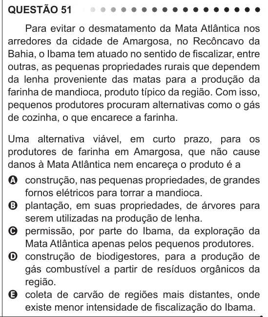

Texto extraído (pode conter ruído)

QUESTÃO 51  
Para evitar o desmatamento da Mata Atlântica nos  
arredores da cidade de Amargosa, no Recôncavo da  
Bahia, o Ibama tem atuado no sentido de fiscalizar, entre  
outras, as pequenas propriedades rurais que dependem  
da lenha proveniente das matas para a produção da  
farinha de mandioca, produto típico da região. Com isso,  
pequenos produtores procuram alternativas como o gás  
de cozinha, o que encarece a farinha.  
Uma alternativa viável, em curto prazo, para os  
produtores de farinha em Amargosa, que não cause  
danos à Mata Atlântica nem encareça o produto é a  
A construção, nas pequenas propriedades, de grandes  
fornos elétricos para torrar a mandioca.  
B plantação, em suas propriedades, de árvores para  
serem utilizadas na produção de lenha.  
C permissão, por parte do Ibama, da exploração da  
Mata Atlântica apenas pelos pequenos produtores.  
D construção de biodigestores, para a produção de  
gás combustível a partir de resíduos orgânicos da  
região.  
E coleta de carvão de regiões mais distantes, onde  
existe menor intensidade de fiscalização do Ibama.

