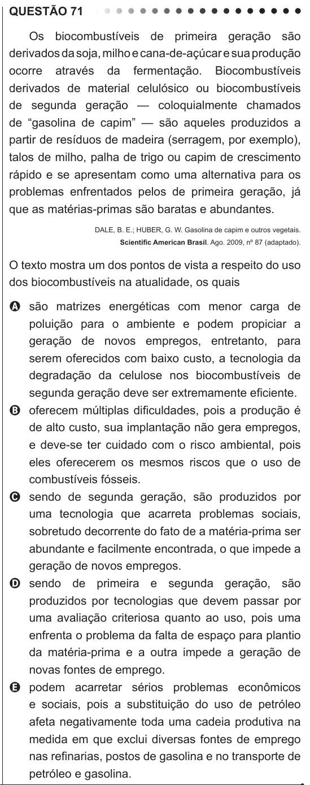

Texto extraído (pode conter ruído)

QUESTÃO 71  
Os biocombustíveis de primeira geração são  
derivados da soja, milho e cana-de-açúcar e sua produção  
ocorre através da fermentação. Biocombustíveis  
derivados de material celulósico ou biocombustíveis  
de segunda geração — coloquialmente chamados  
de “gasolina de capim” — são aqueles produzidos a  
partir de resíduos de madeira (serragem, por exemplo),  
talos de milho, palha de trigo ou capim de crescimento  
rápido e se apresentam como uma alternativa para os  
problemas enfrentados pelos de primeira geração, já  
que as matérias-primas são baratas e abundantes.  
DALE, B. E.; HUBER, G. W. Gasolina de capim e outros vegetais.  
Scientific American Brasil. Ago. 2009, nº 87 (adaptado).  
O texto mostra um dos pontos de vista a respeito do uso  
dos biocombustíveis na atualidade, os quais  
A são matrizes energéticas com menor carga de  
poluição para o ambiente e podem propiciar a  
geração de novos empregos, entretanto, para  
serem oferecidos com baixo custo, a tecnologia da  
degradação da celulose nos biocombustíveis de  
segunda geração deve ser extremamente eficiente.  
B oferecem múltiplas dificuldades, pois a produção é  
de alto custo, sua implantação não gera empregos,  
e deve-se ter cuidado com o risco ambiental, pois  
eles oferecerem os mesmos riscos que o uso de  
combustíveis fósseis.  
C sendo de segunda geração, são produzidos por  
uma tecnologia que acarreta problemas sociais,  
sobretudo decorrente do fato de a matéria-prima ser  
abundante e facilmente encontrada, o que impede a  
geração de novos empregos.  
D sendo de primeira e segunda geração, são  
produzidos por tecnologias que devem passar por  
uma avaliação criteriosa quanto ao uso, pois uma  
enfrenta o problema da falta de espaço para plantio  
da matéria-prima e a outra impede a geração de  
novas fontes de emprego.  
E podem acarretar sérios problemas econômicos  
e sociais, pois a substituição do uso de petróleo  
afeta negativamente toda uma cadeia produtiva na  
medida em que exclui diversas fontes de emprego  
nas refinarias, postos de gasolina e no transporte de  
petróleo e gasolina.

