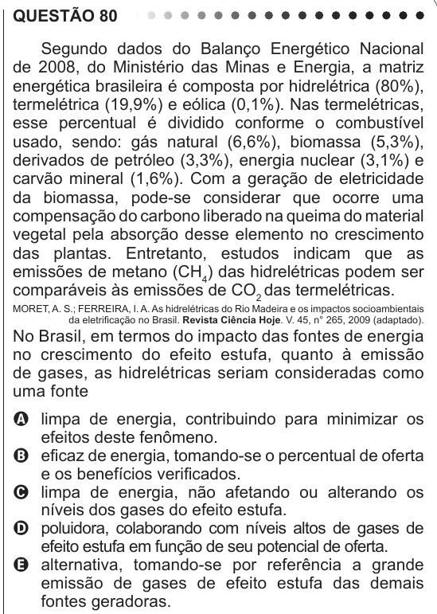

Texto extraído (pode conter ruído)

QUESTÃO 80  
Segundo dados do Balanço Energético Nacional  
de 2008, do Ministério das Minas e Energia, a matriz  
energética brasileira é composta por hidrelétrica (80%),  
termelétrica (19,9%) e eólica (0,1%). Nas termelétricas,  
esse percentual é dividido conforme o combustível  
usado, sendo: gás natural (6,6%), biomassa (5,3%),  
derivados de petróleo (3,3%), energia nuclear (3,1%) e  
carvão mineral (1,6%). Com a geração de eletricidade  
da biomassa, pode-se considerar que ocorre uma  
compensação do carbono liberado na queima do material  
vegetal pela absorção desse elemento no crescimento  
das plantas. Entretanto, estudos indicam que as  
emissões de metano (CH 4 ) das hidrelétricas podem ser  
comparáveis às emissões de CO 2 das termelétricas.  
MORET, A. S.; FERREIRA, I. A. As hidrelétricas do Rio Madeira e os impactos socioambientais  
da eletrificação no Brasil. Revista Ciência Hoje. V. 45, n° 265, 2009 (adaptado).  
No Brasil, em termos do impacto das fontes de energia  
no crescimento do efeito estufa, quanto à emissão  
de gases, as hidrelétricas seriam consideradas como  
uma fonte  
A limpa de energia, contribuindo para minimizar os  
efeitos deste fenômeno.  
B eficaz de energia, tomando-se o percentual de oferta  
e os benefícios verificados.  
C limpa de energia, não afetando ou alterando os  
níveis dos gases do efeito estufa.  
D poluidora, colaborando com níveis altos de gases de  
efeito estufa em função de seu potencial de oferta.  
E alternativa, tomando-se por referência a grande  
emissão de gases de efeito estufa das demais  
fontes geradoras.

