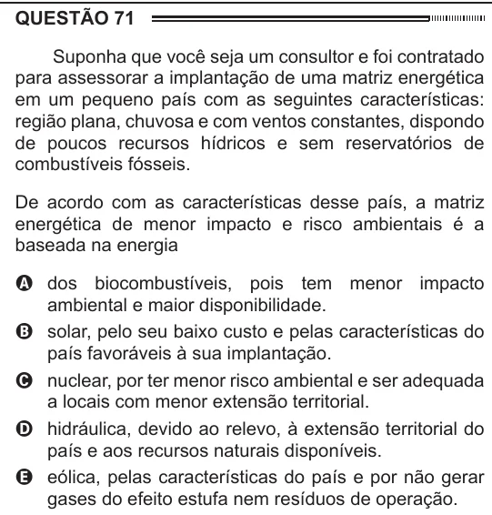

Texto extraído (pode conter ruído)

QUESTÃO 71  
Suponha que você seja um consultor e foi contratado  
para assessorar a implantação de uma matriz energética  
em um pequeno país com as seguintes características:  
região plana, chuvosa e com ventos constantes, dispondo  
de poucos recursos hídricos e sem reservatórios de  
combustíveis fósseis.  
De acordo com as características desse país, a matriz  
energética de menor impacto e risco ambientais é a  
baseada na energia  
A dos biocombustíveis, pois tem menor impacto  
ambiental e maior disponibilidade.  
B solar, pelo seu baixo custo e pelas características do  
país favoráveis à sua implantação.  
C nuclear, por ter menor risco ambiental e ser adequada  
a locais com menor extensão territorial.  
D hidráulica, devido ao relevo, à extensão territorial do  
país e aos recursos naturais disponíveis.  
E eólica, pelas características do país e por não gerar  
gases do efeito estufa nem resíduos de operação.

