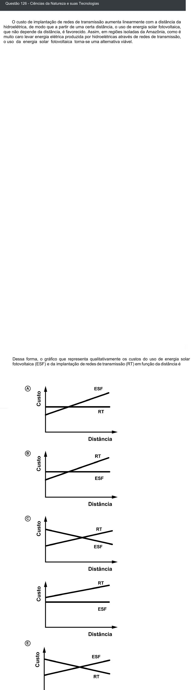

Texto extraído (pode conter ruído)

Questão 126 - Ciências da Natureza e suas Tecnologias  
O custo de implantação de redes de transmissão aumenta linearmente com a distância da  
hidroelétrica, de modo que a partir de uma certa distância, o uso de energia solar fotovoltaica,  
que não depende da distância, é favorecido. Assim, em regiões isoladas da Amazônia, como é  
muito caro levar energia elétrica produzida por hidroelétricas através de redes de transmissão,  
o uso da energia solar fotovoltaica torna-se uma alternativa viável.  
Dessa forma, o gráfico que representa qualitativamente os custos do uso de energia solar  
fotovoltaica (ESF) e da implantação de redes de transmissão (RT) em função da distância é  
A  
B  
C  
E

