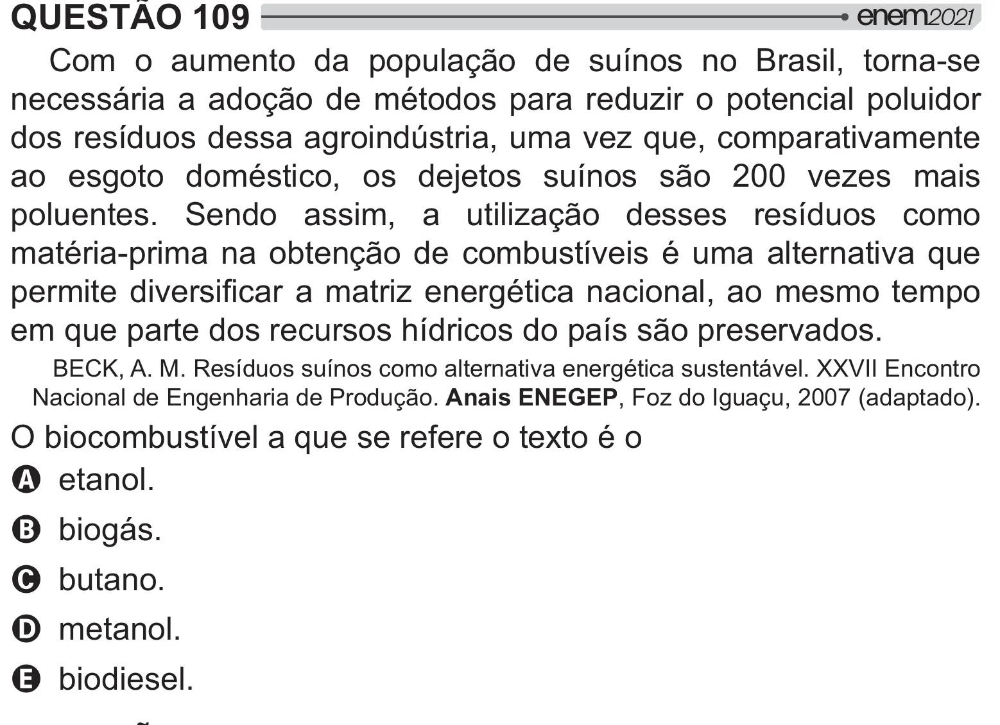

Texto extraído (pode conter ruído)

QUESTÃO 109  
Com o aumento da população de suínos no Brasil, torna-se  
necessária a adoção de métodos para reduzir o potencial poluidor  
dos resíduos dessa agroindústria, uma vez que, comparativamente  
ao esgoto doméstico, os dejetos suínos são 200 vezes mais  
poluentes. Sendo assim, a utilização desses resíduos como  
matéria-prima na obtenção de combustíveis é uma alternativa que  
#  "     <   #  
em que parte dos recursos hídricos do país são preservados.  
BECK, A. M. Resíduos suínos como alternativa energética sustentável. XXVII Encontro  
Nacional de Engenharia de Produção. Anais ENEGEP, Foz do Iguaçu, 2007 (adaptado).  
O biocombustível a que se refere o texto é o  
A etanol.  
B biogás.  
C butano.  
D metanol.  
E biodiesel.

