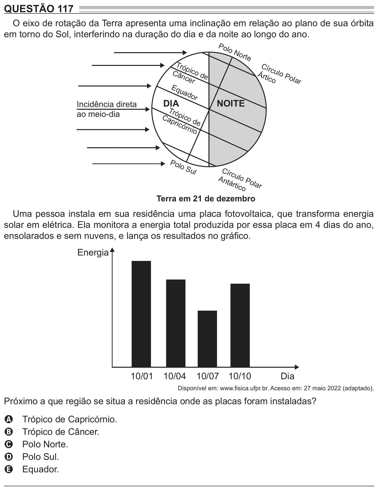

Texto extraído (pode conter ruído)

QUESTÃO 117  
O eixo de rotação da Terra apresenta uma inclinação em relação ao plano de sua órbita  
em torno do Sol, interferindo na duração do dia e da noite ao longo do ano.  
Pol  
o N  
orte  
Tró  
Cír  
p  
Cân ico de  
c  
Árti ulo Po  
cer  
co  
la  
r  
Eq  
uad  
or  
DIA  
NOITE  
Incidência direta  
Tró  
ao meio-dia  
Ca pico  
pric  
d  
órn e  
io  
Pol  
o S  
Cír  
ul  
c  
Ant ulo Po  
árti  
co lar  
Terra em 21 de dezembro  
Uma pessoa instala em sua residência uma placa fotovoltaica, que transforma energia  
solar em elétrica. Ela monitora a energia total produzida por essa placa em 4 dias do ano,  
ensolarados e sem nuvens, e lança os resultados no gráfico.  
Energia  
10/01  
10/04  
10/07 10/10  
Dia  
Disponível em: www.fisica.ufpr.br. Acesso em: 27 maio 2022 (adaptado).  
Próximo a que região se situa a residência onde as placas foram instaladas?  
Trópico de Capricórnio.  
A  
Trópico de Câncer.  
B  
Polo Norte.  
C  
Polo Sul.  
D  
Equador.  
E

