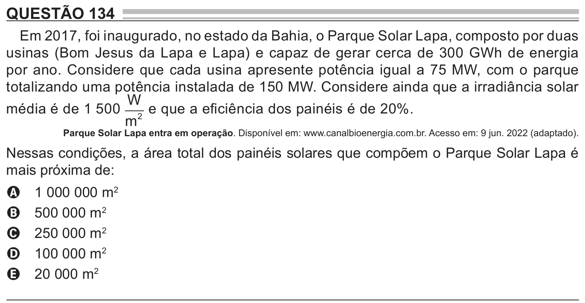

Texto extraído (pode conter ruído)

QUESTÃO 134  
Em 2017, foi inaugurado, no estado da Bahia, o Parque Solar Lapa, composto por duas  
usinas (Bom Jesus da Lapa e Lapa) e capaz de gerar cerca de 300 GWh de energia  
por ano. Considere que cada usina apresente potência igual a 75 MW, com o parque  
totalizando uma potência instalada de 150 MW. Considere ainda que a irradiância solar  
W  
média é de 1 500 2 e que a eficiência dos painéis é de 20%.  
m  
Parque Solar Lapa entra em operação. Disponível em: www.canalbioenergia.com.br. Acesso em: 9 jun. 2022 (adaptado).  
Nessas condições, a área total dos painéis solares que compõem o Parque Solar Lapa é  
mais próxima de:  
1 000 000 m 2  
A  
500 000 m 2  
B  
250 000 m 2  
C  
100 000 m 2  
D  
20 000 m 2  
E

