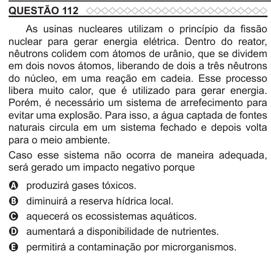

Texto extraído (pode conter ruído)

QUESTÃO 112  
As usinas nucleares utilizam o princípio da fissão  
nuclear para gerar energia elétrica. Dentro do reator,  
nêutrons colidem com átomos de urânio, que se dividem  
em dois novos átomos, liberando de dois a três nêutrons  
do núcleo, em uma reação em cadeia. Esse processo  
libera muito calor, que é utilizado para gerar energia.  
Porém, é necessário um sistema de arrefecimento para  
evitar uma explosão. Para isso, a água captada de fontes  
naturais circula em um sistema fechado e depois volta  
para o meio ambiente.  
Caso esse sistema não ocorra de maneira adequada,  
será gerado um impacto negativo porque  
produzirá gases tóxicos.  
A  
diminuirá a reserva hídrica local.  
B  
aquecerá os ecossistemas aquáticos.  
C  
D  
aumentará a disponibilidade de nutrientes.  
permitirá a contaminação por microrganismos.  
E

