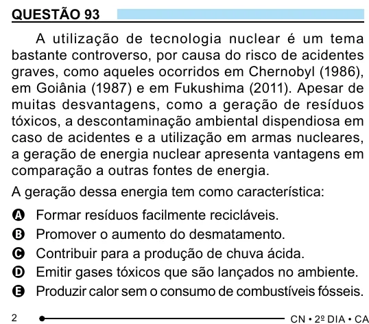

Texto extraído (pode conter ruído)

QUESTÃO 93  
A utilização de tecnologia nuclear é um tema  
bastante controverso, por causa do risco de acidentes  
graves, como aqueles ocorridos em Chernobyl (1986),  
em Goiânia (1987) e em Fukushima (2011). Apesar de  
muitas desvantagens, como a geração de resíduos  
tóxicos, a descontaminação ambiental dispendiosa em  
caso de acidentes e a utilização em armas nucleares,  
a geração de energia nuclear apresenta vantagens em  
comparação a outras fontes de energia.  
A geração dessa energia tem como característica:  
Formar resíduos facilmente recicláveis.  
A  
B  
Promover o aumento do desmatamento.  
Contribuir para a produção de chuva ácida.  
C  
Emitir gases tóxicos que são lançados no ambiente.  
D  
Produzir calor sem o consumo de combustíveis fósseis.  
E  
2

