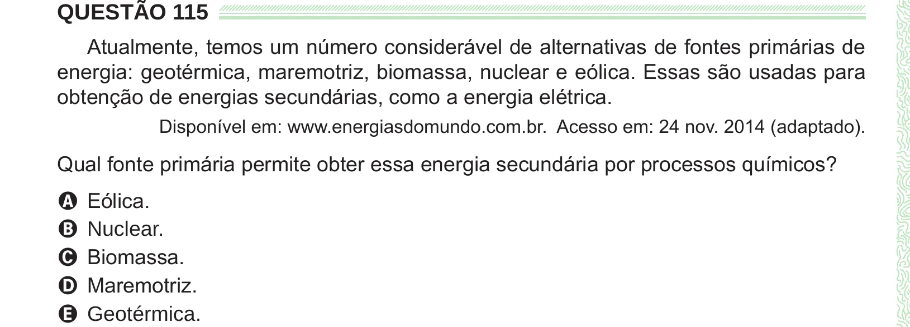

Texto extraído (pode conter ruído)

QUESTÃO 115  
Atualmente, temos um número considerável de alternativas de fontes primárias de  
energia: geotérmica, maremotriz, biomassa, nuclear e eólica. Essas são usadas para  
obtenção de energias secundárias, como a energia elétrica.  
Disponível em: www.energiasdomundo.com.br. Acesso em: 24 nov. 2014 (adaptado).  
Qual fonte primária permite obter essa energia secundária por processos químicos?  
A Eólica.  
B Nuclear.  
C Biomassa.  
D Maremotriz.  
E Geotérmica.

