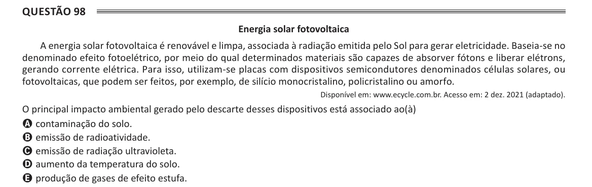

Texto extraído (pode conter ruído)

Questão 98  
Energia solar fotovoltaica  
A energia solar fotovoltaica é renovável e limpa, associada à radiação emitida pelo Sol para gerar eletricidade. Baseia-se no  
denominado efeito fotoelétrico, por meio do qual determinados materiais são capazes de absorver fótons e liberar elétrons,  
gerando corrente elétrica. Para isso, utilizam-se placas com dispositivos semicondutores denominados células solares, ou  
fotovoltaicas, que podem ser feitos, por exemplo, de silício monocristalino, policristalino ou amorfo.  
Disponível em: www.ecycle.com.br. Acesso em: 2 dez. 2021 (adaptado).  
O principal impacto ambiental gerado pelo descarte desses dispositivos está associado ao(à)  
A contaminação do solo.  
B emissão de radioatividade.  
C emissão de radiação ultravioleta.  
D aumento da temperatura do solo.  
E produção de gases de efeito estufa.

