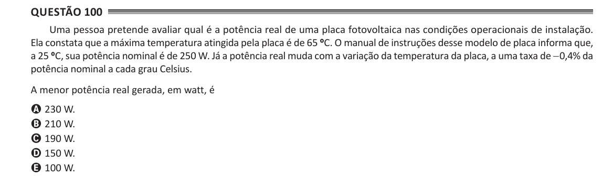

Texto extraído (pode conter ruído)

Questão 100  
Uma pessoa pretende avaliar qual é a potência real de uma placa fotovoltaica nas condições operacionais de instalação.  
Ela constata que a máxima temperatura atingida pela placa é de 65 ° C. O manual de instruções desse modelo de placa informa que,  
a 25 ° C, sua potência nominal é de 250 W. Já a potência real muda com a variação da temperatura da placa, a uma taxa de −0,4% da  
potência nominal a cada grau Celsius.  
A menor potência real gerada, em watt, é  
A 230 W.  
B 210 W.  
C 190 W.  
D 150 W.  
E 100 W.

