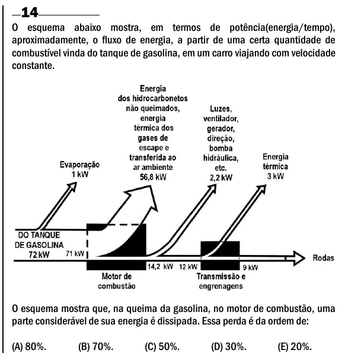

Texto extraído (pode conter ruído)

14  
O esquema abaixo mostra, em termos de potência(energia/tempo),  
aproximadamente, o fluxo de energia, a partir de uma certa quantidade de  
combustível vinda do tanque de gasolina, em um carro viajando com velocidade  
constante.  
O esquema mostra que, na queima da gasolina, no motor de combustão, uma  
parte considerável de sua energia é dissipada. Essa perda é da ordem de:  
(A) 80%.  
(B) 70%.  
(C) 50%.  
(D) 30%.  
(E) 20%.

