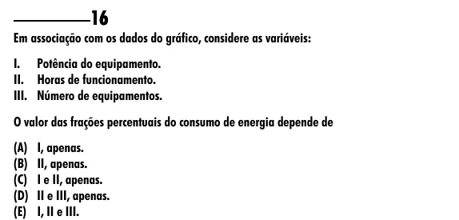

Texto extraído (pode conter ruído)

16  
Em associação com os dados do gráfico, considere as variáveis:  
I. Potência do equipamento.  
II. Horas de funcionamento.  
III. Número de equipamentos.  
O valor das frações percentuais do consumo de energia depende de  
(A) I, apenas.  
(B) II, apenas.  
(C) I e II, apenas.  
(D) II e III, apenas.  
(E) I, II e III.

