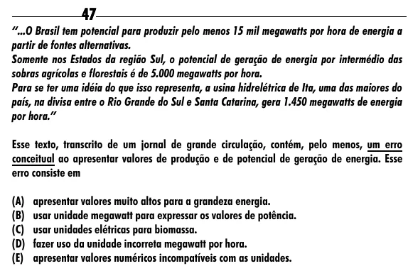

Texto extraído (pode conter ruído)

47  
“...O Brasil tem potencial para produzir pelo menos 15 mil megawatts por hora de energia a  
partir de fontes alternativas.  
Somente nos Estados da região Sul, o potencial de geração de energia por intermédio das  
sobras agrícolas e florestais é de 5.000 megawatts por hora.  
Para se ter uma idéia do que isso representa, a usina hidrelétrica de Ita, uma das maiores do  
país, na divisa entre o Rio Grande do Sul e Santa Catarina, gera 1.450 megawatts de energia  
por hora.”  
Esse texto, transcrito de um jornal de grande circulação, contém, pelo menos, um erro  
conceitual ao apresentar valores de produção e de potencial de geração de energia. Esse  
erro consiste em  
(A) apresentar valores muito altos para a grandeza energia.  
(B) usar unidade megawatt para expressar os valores de potência.  
(C) usar unidades elétricas para biomassa.  
(D) fazer uso da unidade incorreta megawatt por hora.  
(E) apresentar valores numéricos incompatíveis com as unidades.

