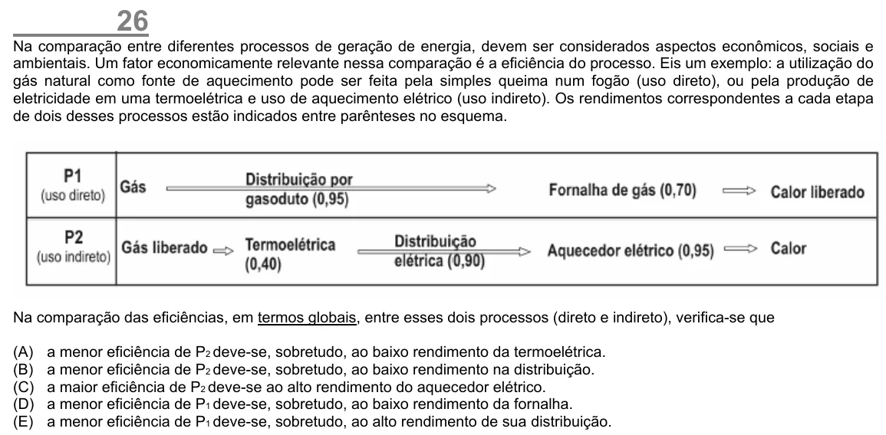

Texto extraído (pode conter ruído)

26  
Na comparação entre diferentes processos de geração de energia, devem ser considerados aspectos econômicos, sociais e  
ambientais. Um fator economicamente relevante nessa comparação é a eficiência do processo. Eis um exemplo: a utilização do  
gás natural como fonte de aquecimento pode ser feita pela simples queima num fogão (uso direto), ou pela produção de  
eletricidade em uma termoelétrica e uso de aquecimento elétrico (uso indireto). Os rendimentos correspondentes a cada etapa  
de dois desses processos estão indicados entre parênteses no esquema.  
Na comparação das eficiências, em termos globais, entre esses dois processos (direto e indireto), verifica-se que  
(A)  
a menor eficiência de P 2 deve-se, sobretudo, ao baixo rendimento da termoelétrica.  
(B)  
a menor eficiência de P 2 deve-se, sobretudo, ao baixo rendimento na distribuição.  
(C)  
a maior eficiência de P 2 deve-se ao alto rendimento do aquecedor elétrico.  
(D)  
a menor eficiência de P 1 deve-se, sobretudo, ao baixo rendimento da fornalha.  
(E)  
a menor eficiência de P 1 deve-se, sobretudo, ao alto rendimento de sua distribuição.

